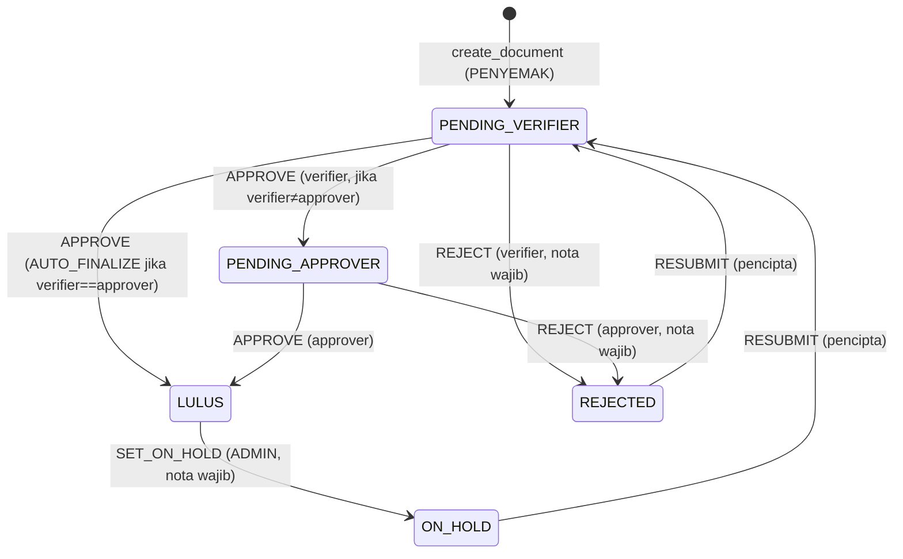

# Seni Bina LogKerja

Dokumen ini menerangkan seni bina hujung-ke-hujung LogKerja. Untuk skema pangkalan data terperinci,
lihat [DATA_MODEL.md](DATA_MODEL.md). Untuk persediaan, lihat [SETUP.md](SETUP.md).

## Gambaran keseluruhan

```
┌─────────────────────────────────────┐        ┌──────────────────────────────┐
│  Klien (React + Vite PWA)           │        │  Supabase                    │
│                                     │        │                              │
│  pages/ ── components/              │  RPC/  │  Postgres (RLS)              │
│     │                               │  auth  │   ├─ jadual + enum           │
│  features/*Api.ts ──────────────────┼───────▶│   ├─ RPC SECURITY DEFINER    │
│     │        (supabase-js)          │        │   └─ Realtime                │
│     │                               │ invoke │  Edge Functions (Deno)       │
│     └─ functions.invoke ────────────┼───────▶│   (documents_*, attachments_*,│
│                                     │        │    push_*)                   │
│  sw.ts (PWA) + pushClient (VAPID)   │        │  Storage (bucket privat)     │
│                                     │        │  Auth (Google OAuth)         │
└─────────────────────────────────────┘        └──────────────────────────────┘
        │                                              ▲
        │ dibungkus oleh                               │ keep-alive
   extension/ (Chrome MV3 side panel)         .github/workflows/supabase-ping.yml
```

Deploy frontend di **Vercel** (`vercel.json` menulis semula semua laluan ke `/index.html` untuk SPA).

## Lapisan aplikasi

- **Entry** (`src/main.tsx`): daftar service worker (`virtual:pwa-register`), kendali redirect kod
  OAuth (`exchangeCodeForSession`), render `<App/>`.
- **Routing** (`src/routes/AppRouter.tsx`): laluan awam (`/login`, `/role-picker`) dan laluan
  dilindungi di bawah `/app` (guna `AppShell`). Juga mengendali sesi auth dan mesej `postMessage`
  daripada tetingkap popup login. Untuk pengesah/pelulus, `useMediaQuery('(max-width: 768px)')`
  menukar antara dashboard desktop dan halaman mobile (home/tindakan/history).
- **Lapisan API** (`src/features/*/`): satu-satunya tempat yang bercakap dengan Supabase.
  `penyemakApi.ts`, `pengesahApi.ts`, `pelulusApi.ts`, `adminApi.ts`, `attachmentsApi.ts`,
  `pushClient.ts`. Bacaan guna `supabase.from(...)`; tulisan status guna `supabase.functions.invoke(...)`.
- **Lib** (`src/lib/`): `supabaseClient.ts` (init, `flowType: 'pkce'`), `auth.ts` (bootstrap profil,
  fetch peranan, active-role), `roles.ts` (peta peranan → laluan).

**Tiada pengurusan state global** (tiada Redux/Zustand). State datang daripada hook React,
`localStorage` (peranan aktif), dan langganan Realtime Supabase.

## Aliran autentikasi

1. Pengguna klik "Teruskan dengan Google" (`Login.tsx`) → `supabase.auth.signInWithOAuth({ provider: 'google' })`.
2. Login dibuka dalam **tetingkap popup** untuk elak sekatan iframe/side-panel Chrome. Bila sesi
   wujud dalam popup, ia `postMessage({ type: 'popup-login-success', session })` ke opener lalu tutup.
3. Ada fallback: tulis sesi ke `localStorage` (`sb-<projectref>-auth-token`) bila `setSession` gagal 403.
4. `RolePicker.tsx`: `checkAndBootstrapProfile` (auto-cipta baris `profiles` jika PGRST116) +
   `fetchUserRoles` (dari `user_roles`). Jika satu peranan → auto-route; jika banyak → pengguna pilih.
   Akaun `is_active=false` atau tanpa peranan disekat.
5. Dashboard guna **`getSession`** (bukan `getUser`) untuk elak 403 & kick `SIGNED_OUT` dari Vercel.

> ⚠️ Aliran auth ini rapuh dengan **sengaja** untuk berfungsi dalam extension side panel. Jangan
> ubah tanpa menguji dalam extension. Lihat siri `fix(auth)` dalam [CHANGELOG.md](CHANGELOG.md).

## Aliran kelulusan dokumen

State machine dikuatkuasa **sepenuhnya di pelayan** dalam RPC `transition_document`
(row lock `FOR UPDATE`, semak identiti pelaku). Setiap peralihan menulis rekod `document_actions`
(audit tak boleh ubah).



- Verifier & approver **diberikan automatik** daripada `category_routing` semasa cipta (dan dikira
  semula semasa resubmit).
- Klien memanggil `documents_transition` dengan body `{ doc_id, action, note }` di mana `action` ialah
  `APPROVE` / `REJECT` / `RESUBMIT` / `SET_ON_HOLD`. Edge Function memanggil RPC yang memetakan ke
  jenis tindakan sebenar (`APPROVE_VERIFIER`, `AUTO_FINALIZE`, dll).

## Edge Functions (Deno)

Semua di `supabase/functions/`. Corak auth: sahkan Bearer JWT guna klien **anon**
(`auth.getUser(token)`), kemudian tulis DB privileged guna **service-role key**.

| Function | Peranan |
| --- | --- |
| `documents_create` | Panggil RPC `create_document`; cetus `push_send` ke verifier lalai |
| `documents_transition` | Semua peralihan status (panggil RPC `transition_document`) |
| `attachments_upload_init` | Mula muat naik selamat ke bucket privat |
| `attachments_register` | Daftar metadata lampiran |
| `attachments_signed_url` | Jana signed URL bersemak-peranan untuk lihat lampiran |
| `push_register` | Daftar langganan Web Push |
| `push_send` | Hantar Web Push (VAPID); buang langganan mati |

## Realtime

Digunakan untuk kad KPI langsung dan kaunter badge (T7.1, T7.3). Langganan **berskop** dengan
penapis lajur betul — `verifier_id=eq.<user>` / `approver_id=eq.<user>` — untuk elak kebocoran data.
(Pepijat lama: penapis pada lajur tak wujud `assigned_verifier`; kini `verifier_id`/`approver_id`.)

## PWA & Push

- `vite-plugin-pwa` (strategi `injectManifest`, service worker tersuai `src/sw.ts`).
- Manifest: nama "LogKerja System", tema `#2563eb`, standalone/portrait.
- Web Push guna VAPID (`VITE_VAPID_PUBLIC_KEY`); langganan diuruskan oleh
  `src/features/notifications/pushClient.ts`, dihantar melalui `push_send`.
- Push dicetus semasa dokumen dicipta (`documents_create` → `push_send` ke verifier lalai).

## Extension Chrome

Folder `extension/` — MV3 side panel yang membungkus PWA. Ada `service_worker.js`, `sidepanel.js`
(kaunter badge realtime), `manifest.json`, ikon. Lihat [extension/README.md](../extension/README.md).

## Deploy & infra

- **Vercel** untuk frontend; `vercel.json` rewrite SPA.
- **Supabase** untuk backend (project ref `csimvhrkwpoeyncqxvus`).
- **GitHub Action** `.github/workflows/supabase-ping.yml` — ping REST harian (00:00 UTC) untuk
  kekalkan Supabase free-tier aktif.

## Keselamatan & integriti

RLS didayakan pada kesemua 8 jadual. Tulisan status hanya melalui RPC SECURITY DEFINER. Lampiran
dalam bucket **privat**, diakses hanya via signed URL bersemak-peranan. Rujukan audit penuh:
[../QA_CHECKLIST.md](../QA_CHECKLIST.md) (T6.0).
