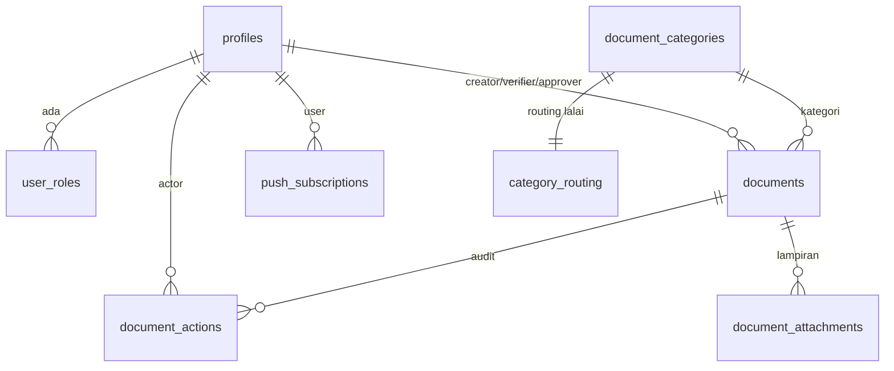

# Model Data LogKerja

Skema Postgres (skema `public`, RLS didayakan pada semua jadual). Sumber kebenaran:
`supabase/migrations/`. Skema teras: `20260223073724_logkerja_v2_schema.sql`.

## Enum

| Enum | Nilai |
| --- | --- |
| `app_role` | `ADMIN`, `PENYEMAK`, `PENGESAH`, `PELULUS` |
| `document_status` | `PENDING_VERIFIER`, `PENDING_APPROVER`, `REJECTED`, `LULUS`, `ON_HOLD` |
| `document_action_type` | `CREATE`, `APPROVE_VERIFIER`, `APPROVE_APPROVER`, `REJECT_VERIFIER`, `REJECT_APPROVER`, `AUTO_FINALIZE`, `RESUBMIT`, `SET_ON_HOLD` |

## Rajah hubungan

## Jadual

### `profiles`
Satu baris per pengguna auth. Auto-cipta semasa login pertama (`checkAndBootstrapProfile`).

| Lajur | Jenis | Nota |
| --- | --- | --- |
| `id` | uuid PK | FK → `auth.users` |
| `full_name` | text | wajib |
| `email` | text | ditambah dalam `20260224042854_add_profiles_email.sql`; diisi semasa login |
| `is_active` | boolean | lalai `true`; `false` = disekat di RolePicker |
| `created_at` / `updated_at` | timestamptz | trigger `set_updated_at` |

### `user_roles`
Many-to-many pengguna ↔ peranan (pengguna boleh ada banyak peranan).

| Lajur | Jenis | Nota |
| --- | --- | --- |
| `user_id` | uuid | FK → `profiles(id)`, on delete cascade |
| `role` | app_role | |
| | | PK gabungan `(user_id, role)` |

### `document_categories`

| Lajur | Jenis |
| --- | --- |
| `id` | uuid PK (gen_random_uuid) |
| `name` | text |
| `description` | text (nullable) |
| `is_active` | boolean (lalai true) |
| `created_at` / `updated_at` | timestamptz |

### `category_routing`
Memacu pemberian verifier/approver automatik per kategori.

| Lajur | Jenis | Nota |
| --- | --- | --- |
| `category_id` | uuid PK | FK → `document_categories(id)`, cascade |
| `default_verifier_id` | uuid | FK → `profiles(id)`, wajib |
| `default_approver_id` | uuid | FK → `profiles(id)`, wajib |
| `created_at` / `updated_at` | timestamptz | |

### `documents`

| Lajur | Jenis | Nota |
| --- | --- | --- |
| `id` | uuid PK | |
| `reference_no` | text | **unik** |
| `category_id` | uuid | FK → `document_categories(id)` |
| `creator_id` | uuid | FK → `profiles(id)` |
| `current_status` | document_status | |
| `description` | text (nullable) | |
| `verifier_id` | uuid (nullable) | FK → `profiles(id)`; diberi dari routing |
| `approver_id` | uuid (nullable) | FK → `profiles(id)`; diberi dari routing |
| `created_at` / `updated_at` | timestamptz | |

> ⚠️ Jangan `UPDATE` jadual ini terus untuk perubahan status. Guna RPC `transition_document`.
> Indeks pada `creator_id`, `verifier_id`, `approver_id`.

### `document_actions`
Audit trail tak boleh ubah — satu baris per peralihan.

| Lajur | Jenis | Nota |
| --- | --- | --- |
| `id` | uuid PK | |
| `document_id` | uuid | FK → `documents(id)`, cascade |
| `actor_id` | uuid | FK → `profiles(id)` |
| `action` | document_action_type | |
| `from_status` | document_status (nullable) | null untuk `CREATE` |
| `to_status` | document_status | |
| `note` | text (nullable) | wajib untuk REJECT / SET_ON_HOLD |
| `created_at` | timestamptz | |

### `document_attachments`
Metadata fail; fail sebenar dalam Storage bucket privat `document-attachments`.

| Lajur | Jenis |
| --- | --- |
| `id` | uuid PK |
| `document_id` | uuid FK → `documents(id)` cascade |
| `file_path` | text |
| `file_name` | text |
| `content_type` | text |
| `size_bytes` | bigint |
| `uploaded_by` | uuid FK → `profiles(id)` |
| `created_at` | timestamptz |

### `push_subscriptions`

| Lajur | Jenis | Nota |
| --- | --- | --- |
| `id` | uuid PK | |
| `user_id` | uuid | FK → `profiles(id)`, cascade |
| `subscription` | jsonb | objek langganan Web Push |
| `created_at` / `updated_at` | timestamptz | |

## Storage

- Bucket **`document-attachments`** — privat (`public=false`), migration
  `20260224042906_logkerja_v2_storage.sql`. Diakses hanya via signed URL (Edge Function
  `attachments_signed_url`, bersemak-peranan).

## Fungsi RPC / DB (SECURITY DEFINER)

| Fungsi | Tandatangan | Fungsi |
| --- | --- | --- |
| `create_document` | `(p_ref_no text, p_cat_id uuid, p_desc text) → uuid` | Cipta dokumen (semak PENYEMAK & aktif), set routing, status `PENDING_VERIFIER`, tulis audit `CREATE` |
| `transition_document` | `(p_doc_id uuid, p_action text, p_note text default null) → void` | Kuatkuasa state machine (lihat [ARCHITECTURE.md](ARCHITECTURE.md)); row lock `FOR UPDATE`; tulis audit |
| `has_role` | `(check_role app_role) → boolean` | Semak sama ada `auth.uid()` ada peranan |
| `is_active_user` | `() → boolean` | Semak `profiles.is_active` untuk `auth.uid()` |
| `get_routing_for_category` | `(cat_id uuid) → record` | Pulang verifier/approver lalai kategori |
| `set_updated_at` | trigger | Kemas `updated_at` pada UPDATE |

Klien memanggil RPC ini secara **tidak langsung** melalui Edge Functions (`documents_create`,
`documents_transition`), bukan `.rpc()` terus dari frontend.

## Corak RLS (ringkasan)

- Pengguna nampak profil/peranan/langganan-push sendiri.
- `documents`/`document_actions`/`document_attachments` nampak kepada: pencipta, verifier ditugaskan,
  approver ditugaskan, atau ADMIN.
- Tulisan ke `documents` hanya melalui RPC SECURITY DEFINER (grant langsung SELECT sahaja +
  `update(full_name)`/insert terhad pada profiles). ADMIN urus penuh via `has_role('ADMIN')`.
- Pembetulan RLS/grant lanjutan: lihat migration `*_grants*.sql`, `*_admin_update.sql`,
  `*_admin_delete_documents.sql`, `*_optimistic_locking_and_indexes.sql`.

## Senarai migration (kronologi)

Semua dalam `supabase/migrations/`:
`logkerja_v2_schema` → `enable_realtime` → `logkerja_v2_rls_policies` → `profiles_select_minimal` →
`add_profiles_email` → `logkerja_v2_storage` → `grant_update_email` → `logkerja_admin_update` →
`logkerja_v2_optimistic_locking_and_indexes` → `fix_category_routing_grants` → `fix_user_roles_grants` →
`fix_document_categories_grants` → `fix_category_routing_grants2` → `fix_admin_delete_documents`.
